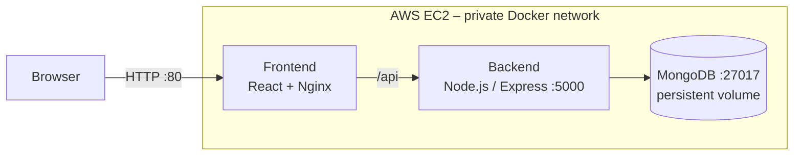
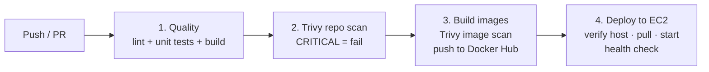

# Expense Tracker – DevSecOps CI/CD Pipeline

[](https://github.com/hossenra/expense-tracker-devsecops/actions/workflows/devsecops.yml)

A full-stack expense tracker (React, Node.js, MongoDB) with an automated **DevSecOps pipeline**: every push to `main` is linted, tested, security-scanned with Trivy, packaged as versioned Docker images and deployed to AWS EC2 – with no manual steps. The same images also run on **Kubernetes**.

> The focus of this project is not the app itself but the delivery process behind it: repeatable, reviewable and secure by default.

---

## Highlights

- **Fully automated delivery** – `git push` → tests → security scan → build → deploy → health check
- **Security gates** – the pipeline stops on any lint/test failure or **Critical** vulnerability; nothing unsafe reaches production
- **Immutable, traceable releases** – images are tagged with the Git commit SHA (no `latest`), so every running version maps to exact source code
- **Trusted deployment channel** – the pipeline verifies the server's SSH host fingerprint before connecting and uses a dedicated deploy key
- **Minimal attack surface** – only port 80 is public; backend and database are reachable only inside the private Docker network
- **Runs on Docker Compose and Kubernetes** – same images, two runtimes (see [`k8s/`](k8s/))

---

## Architecture



| Component | Technology                                                              | Exposed          |
| --------- | ----------------------------------------------------------------------- | ---------------- |
| Frontend  | React (Vite), served by Nginx; Nginx also proxies `/api` to the backend | Port 80 (public) |
| Backend   | Node.js 22, Express, REST API with `/api/health`                        | Internal only    |
| Database  | MongoDB 7, named volume `mongo-data`                                    | Internal only    |

---

## CI/CD Pipeline



| Stage                     | What happens                                                                                                                                       | Fails when                                           |
| ------------------------- | -------------------------------------------------------------------------------------------------------------------------------------------------- | ---------------------------------------------------- |
| **1. Quality**            | ESLint, unit tests (backend + frontend), production build                                                                                          | Any lint error or failing test                       |
| **2. Repository scan**    | Trivy scans the source tree and dependencies                                                                                                       | A **Critical** finding, or the scanner itself errors |
| **3. Image build & scan** | Builds frontend/backend images, scans each with Trivy, pushes `razibul93/expense-*:<commit-sha>` to Docker Hub only if clean                       | Build error or **Critical** image vulnerability      |
| **4. Deploy**             | Verifies the EC2 SSH fingerprint, uploads `docker-compose.prod.yml`, pulls the new images, restarts the stack, checks `/api/health` up to 30 times | SSH/host mismatch, pull error, failed health check   |

- **Pull requests** run stages 1–2 only (no publishing, no deployment).
- **Pushes to `main`** run the full pipeline.
- Each stage depends on the previous one: a failure blocks everything after it.

---

## Security Design Decisions

| Decision                                                            | Why                                                                                                        |
| ------------------------------------------------------------------- | ---------------------------------------------------------------------------------------------------------- |
| Block only on **Critical** findings                                 | Keeps the pipeline usable while stopping the most dangerous issues; High/Medium are reported for follow-up |
| Treat **scanner errors as failures**                                | A scan that didn't run is not a passed scan                                                                |
| **Commit-SHA image tags** instead of `latest`                       | Reproducible deployments and clear rollback targets                                                        |
| **SSH host fingerprint verification** (`StrictHostKeyChecking=yes`) | Prevents connecting to a spoofed server                                                                    |
| **Dedicated deploy key** for the pipeline                           | Separate from personal access; can be rotated or revoked without affecting anyone else                     |
| Secrets only in **GitHub Actions Secrets**                          | No credentials in code, images or logs                                                                     |
| Database **not exposed**                                            | MongoDB is reachable only from the backend container                                                       |

> A clean Trivy scan reduces known risk; it is not proof of security.

---

## Tech Stack

**App:** React · Vite · Nginx · Node.js 22 · Express · MongoDB 7
**Containers:** Docker · Docker Compose · Kubernetes (KIND)
**CI/CD & Security:** GitHub Actions · Trivy · Docker Hub
**Cloud:** AWS EC2 (Ubuntu)

---

## Project Structure

```
.
├── .github/workflows/devsecops.yml   # CI/CD pipeline
├── backend/                          # Express API (src/, tests/, Dockerfile)
├── frontend/                         # React app + Nginx config (src/, nginx/, tests/, Dockerfile)
├── k8s/                              # Kubernetes manifests (Deployments, StatefulSet, Services, Kustomize)
├── docker-compose.yml                # Local development (builds from source)
├── docker-compose.prod.yml           # Production on EC2 (pulls images from Docker Hub)
└── .env.example                      # Example environment variables
```

---

## Run Locally

**Requirements:** Node.js 22, Docker with Compose v2.

```bash
# Quality checks (same as the pipeline)
cd backend  && npm install && npm run lint && npm test
cd ../frontend && npm install && npm run lint && npm test && npm run build
cd ..

# Start the full stack
docker compose up -d --build
curl -f http://localhost/api/health
```

Open **http://localhost**. Stop with `docker compose down` (data is kept in the `mongo-data` volume).

---

## Deployment Setup

<details>
<summary><b>1. Docker Hub</b></summary>

Create the repositories `expense-backend` and `expense-frontend` and a personal access token with read/write access.

</details>

<details>
<summary><b>2. EC2 server (Ubuntu)</b></summary>

- Instance: t3.small or larger, 20 GB disk, inbound TCP 80 (users) and TCP 22 (deployment).
- Install Docker:

```bash
sudo apt update && sudo apt install -y docker.io docker-compose-v2
sudo systemctl enable --now docker
sudo usermod -aG docker "$USER"   # then log out and back in
mkdir -p ~/expense-tracker
```

- Get the host fingerprint for the pipeline:

```bash
sudo ssh-keygen -lf /etc/ssh/ssh_host_ed25519_key.pub -E sha256
```

</details>

<details>
<summary><b>3. GitHub Actions secrets and variables</b></summary>

| Name                   | Type     | Value                                   |
| ---------------------- | -------- | --------------------------------------- |
| `EC2_HOST`             | Variable | EC2 public IP or DNS                    |
| `EC2_USER`             | Variable | `ubuntu`                                |
| `EC2_HOST_FINGERPRINT` | Variable | `SHA256:...` from the step above        |
| `DOCKERHUB_USERNAME`   | Variable | Docker Hub username                     |
| `EC2_SSH_KEY`          | Secret   | Private deploy key (full file contents) |
| `DOCKERHUB_TOKEN`      | Secret   | Docker Hub access token                 |

Optional: create a `production` environment with required reviewers for manual approval.

</details>

<details>
<summary><b>4. Deploy</b></summary>

Push to `main`. The pipeline deploys automatically. Verify on the server:

```bash
docker compose -f ~/expense-tracker/docker-compose.prod.yml ps
curl -f http://localhost/api/health
```

</details>

---

## Kubernetes

The same images run on Kubernetes. See [`k8s/README.md`](k8s/README.md).

- Frontend and backend as **Deployments** (2 replicas each, rolling updates, readiness/liveness probes)
- MongoDB as a **StatefulSet** with a persistent volume
- Configuration in a **ConfigMap**, images managed with **Kustomize**
- Demonstrates self-healing, scaling, rolling updates and rollback

```bash
kind create cluster --config=k8s/kind-config.yaml --name=expense
kubectl apply -k k8s/
```

---

## Troubleshooting Notes (real issues solved)

| Problem                                          | Cause                                                            | Fix                                                                                                |
| ------------------------------------------------ | ---------------------------------------------------------------- | -------------------------------------------------------------------------------------------------- |
| Pipeline could not resolve `trivy-action@0.33.1` | Upstream tag naming changed                                      | Updated to a valid release tag; long-term: pin actions to commit SHAs                              |
| Deploy failed: `Load key: error in libcrypto`    | Private key in the GitHub secret was corrupted during copy/paste | Created a dedicated ed25519 deploy key, copied it with `pbcopy`, revoked the old key on the server |
| Kubernetes pods stuck in `ImagePullBackOff`      | Node disk full (`no space left on device`)                       | Found via `kubectl describe pod`; enlarged the EBS volume and resized the filesystem               |
| `docker: permission denied` on EC2               | User not yet in the `docker` group in the current session        | `usermod -aG docker` and re-login                                                                  |

---

## Roadmap

- [ ] Pin GitHub Actions to commit SHAs
- [ ] HTTPS with a domain and TLS certificate
- [ ] MongoDB authentication and automated backups
- [ ] Automatic rollback when the health check fails
- [ ] Infrastructure as Code: Terraform for EC2, Ansible for server setup
- [ ] Monitoring with Prometheus and Grafana
- [ ] Continuous deployment to Kubernetes from the pipeline

---

## Author

**Razibul Hossen** – DevOps / Cloud Engineering
[GitHub](https://github.com/hossenra) · [LinkedIn](https://www.linkedin.com/in/razibul-hossen-b0573aa3/) · [Portfolio](https://razibul-portfolio.netlify.app/)

_Based on a DevSecOps lab from the bongoDev DevOps & Cloud Engineering bootcamp; extended with Kubernetes manifests, a dedicated deploy-key setup and documentation of real troubleshooting._
